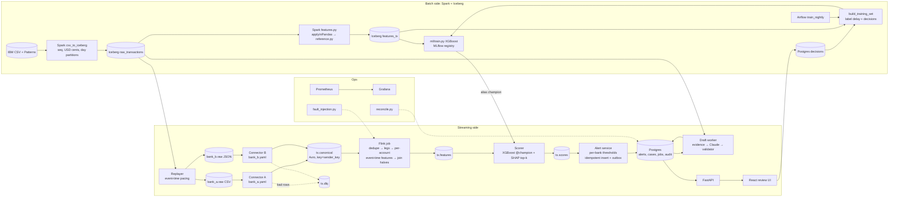

# 02 — Architecture, stack, and the data contracts in one place

## 1. Revised architecture



### One transaction's path (what to say in an interview)
1. **M1:** the CSV row becomes a row in `raw_transactions` with `tx_id`=`seq` (its position after a stable sort by `(timestamp, file row)`), `sender_key` = `bank:account`, and amounts in minor units and USD cents.
2. **Replayer:** waits until the replay clock reaches the row's event time, then emits it to `bank_a.raw` (CSV line) or `bank_b.raw` (JSON), depending on which bank owns the sender. It adds a Kafka header `replay_emit_ts_ms`. **No label is sent.**
3. **Connector:** parses the row, maps it with the bank's YAML, validates it and computes USD cents. It produces an Avro `CanonicalTx` to `tx.canonical` (key `sender_key`). Rows that fail go to `tx.dlq` with the reason.
4. **Flink:** drops duplicate `tx_id`s, then splits the transaction into an OUT leg keyed by sender and an IN leg keyed by receiver. Each account buffers its legs until the watermark passes, processes them in `(event_ts, tx_id)` order, emits its features *as of just before the transaction*, then appends the leg to its log. The two halves are joined by `tx_id` and written as a `FeatureVector` to `tx.features`.
5. **Scorer:** reads committed records in batches, checks `spec_version`, predicts, adds SHAP top-5 for candidates, and produces a `Score` to `tx.scores`.
6. **Alert service:** if the score is at or above the bank's threshold, one Postgres transaction inserts the alert (`ON CONFLICT DO NOTHING`), upserts the case (one per bank, subject account and day), enqueues a draft job and writes the audit log. Only then is the Kafka offset committed.
7. **Draft worker:** claims the job (`FOR UPDATE SKIP LOCKED`), builds the evidence subgraph as of the alert, calls Claude with structured output, validates every cited ID and amount (retrying once if needed), and stores the draft. The case status becomes `ready`.
8. **Analyst:** opens the case, reads the draft (clicking a `tx_id` highlights the edge), and escalates or dismisses. The decision goes into `decisions` and `audit_log`.
9. **Nightly** (in replay-day terms): training data = ground-truth labels older than the label delay + analyst decisions. The model is retrained, gated, and promoted by setting the `champion` alias. The scorer hot-swaps it, and every score records `model_version`.
10. **v2 additions** (milestone sections "Revision v2 additions"): account IDs are aliased before step 7's LLM call, and a failed Haiku draft is retried on Sonnet; analysts' draft feedback grows a regression eval set that gates prompt changes; a hash-sampled slice just below the threshold goes to a QA queue; threshold changes are proposed and approved by different people before the alert service picks them up; a drift monitor compares each day with the serving model's baseline. Every API query runs under Postgres row-level security for the user's bank.

## 2. Components and technologies

| Component | Tech (pin the latest patch at M0, record it in decisions) | Lang | Local | Cloud (M9) | Who writes it |
|---|---|---|---|---|---|
| Event bus | Redpanda (Kafka API + schema registry + console) | — | compose | Strimzi Kafka 4.2.x (KRaft, 3 nodes on m7i-flex.large) + Confluent-compatible schema registry | Claude Code |
| Lakehouse | Apache Iceberg; JDBC catalog on Postgres locally, AWS Glue catalog in cloud | — | filesystem warehouse `var/warehouse` | S3 + Glue Data Catalog; Athena for ad-hoc SQL (all allowed on your Free plan) | Claude Code |
| Batch compute | Spark 3.5.x + `iceberg-spark-runtime-3.5_2.12` | PySpark | `local[*]` in a uv venv | AWS Glue 5.1 Spark jobs (Spark 3.5.6). EMR isn't available on your Free plan | Claude Code; you write `reference.py` |
| Stream compute | Flink 1.20 LTS, DataStream API, HashMap state backend (RocksDB experiment at scale) | Java 17 | compose JobManager + TaskManager | Flink Kubernetes Operator | You own the keyed functions; Claude Code the rest |
| Feature spec | `features/spec.yaml` → generated `feature_names_v1.txt` | YAML | — | — | You (given) |
| Model | XGBoost (hist), optional LightGBM | Python | — | — | Claude Code + you on evaluation |
| Registry/tracking | MLflow 3.x, model aliases `champion` and `challenger` | — | compose | Champion artifact exported to S3 for the scale run | Claude Code |
| Scorer / alerts / connectors / replayer | confluent-kafka, fastavro, psycopg 3 | Python 3.11 | compose `apps` profile | Deployments on EKS | Claude Code |
| Case store | Postgres 17 | SQL | compose | In-cluster StatefulSet (no RDS) | Contracts given |
| LLM agent | Anthropic Python SDK, structured outputs (`output_config.format`), prompt caching, Batch API for evals | Python | compose | Disabled except a 100-case sample | You own the validator |
| API | FastAPI | Python | compose | not deployed | Claude Code |
| UI | React + TypeScript (Vite), TanStack Query, Cytoscape.js | TS | `npm run dev` | not deployed (video) | Claude Code |
| Orchestration | Airflow 3.x (`airflow standalone`, dev only) | Python | compose `orchestration` profile | not deployed | Claude Code |
| Observability | Prometheus + Grafana (dashboards as JSON) | — | compose `obs` profile | kube-prometheus-stack | Claude Code |
| IaC | Terraform (S3 backend, `use_lockfile`), Helm | HCL/YAML | — | VPC, EKS (free-tier node types), S3, ECR, IAM, Glue jobs + Data Catalog, Budgets | Claude Code, reviewed by the `cost-guard` agent |
| CI | GitHub Actions: ruff, pytest (unit), `mvn verify`, `tsc --noEmit` | — | — | — | Claude Code |

**Why these choices (one line each, for interviews)**
- **Redpanda locally:** a single container gives you a Kafka-compatible broker, schema registry and UI, which saves RAM on a laptop. It speaks the same protocol as the Strimzi Kafka you run in the cloud.
- **Iceberg:** time-travel, schema evolution and engine-neutral tables. Spark writes them; DuckDB, PyIceberg and Athena read them.
- **Flink, not Spark Structured Streaming:** per-key timers and event-time state are first-class in Flink, which is what the leg-buffering design needs.
- **Java for Flink:** typed, the production norm, and faster than PyFlink for keyed state. It also adds a typed language to your resume.
- **XGBoost:** fast, explainable with per-row SHAP (`pred_contribs`), and its inputs can be computed in a stream.
- **Postgres outbox, not a second broker for jobs:** the case insert and its job insert commit together, so no draft job is ever lost.

## 3. Kafka topics

| Topic | Key | Value | Partitions local / EKS | Retention | Producer → Consumer |
|---|---|---|---|---|---|
| `bank_a.raw` | sender account | CSV line (UTF-8) | 6 / 12 | 24 h | replayer → connector A |
| `bank_b.raw` | sender account | JSON | 6 / 12 | 24 h | replayer → connector B |
| `bank_c.raw` | sender account | Bank C format (M10) | 3 / — | 24 h | replayer → connector C |
| `tx.canonical` | `sender_key` | Avro `CanonicalTx` | 12 / 12 | 48 h | connectors → Flink |
| `tx.dlq` | source topic | JSON {raw, error, source_offset, mapping_version} | 1 / 3 | 7 d | connectors → you |
| `tx.late` | `tx_id` | Avro `CanonicalTx` | 1 / 3 | 7 d | Flink side output → metrics |
| `tx.features` | `tx_id` | Avro `FeatureVector` | 12 / 12 | 24 h | Flink → scorer |
| `tx.scores` | `tx_id` | Avro `Score` | 12 / 12 | 48 h | scorer → alert service, reconcile |

At HI-Large scale, set `retention.bytes` and enable `compression.type=zstd`. At about 600 bytes per feature record × 180M rows × RF3, `tx.features` alone needs hundreds of GB of disk. [Likely]

## 4. Iceberg tables (namespace `aml_<dataset>`, e.g. `aml_hi_small`)

| Table | Grain | Partition | Key columns |
|---|---|---|---|
| `raw_transactions` | 1 row per transaction | `days(event_ts)` | `tx_id`(=seq), `event_ts`, `event_ts_ms`, `sender_bank`, `sender_account`, `sender_key`, `receiver_*`, `amount_paid_minor`, `payment_currency`, `amount_received_minor`, `receiving_currency`, `amount_paid_usd_cents`, `amount_received_usd_cents`, `payment_format`, `owner_bank_id` (A/B), `is_laundering`, `split` |
| `patterns` | 1 row per (attempt, transaction) | — | `attempt_id`, `pattern_type`, `pattern_detail`, `tx_id` |
| `features_tx` | 1 row per transaction | `days(event_ts)` | `tx_id`, `spec_version`, one column per feature (names from `feature_names_v1.txt`) |
| `training_examples` | 1 row per training transaction per build | `build_id` | `tx_id`, features, `label`, `label_source` (`ground_truth` or `decision`), `as_of` |
| `decisions` | exported nightly from Postgres | `days(decided_at)` | `case_id`, `tx_ids`, `decision`, `reviewer`, `decided_at` |

`is_laundering` lives **only** in `raw_transactions` and `training_examples`. The leakage tests assert that it appears in no topic schema, no feature list and no evidence query.

## 5. Contracts (files in `starter-kit/contracts/`)
- `canonical_tx.avsc`, `feature_vector.avsc`, `score.avsc`: Kafka value schemas. The registry runs `BACKWARD` compatibility.
- `postgres_schema.sql`: alerts, cases, case_jobs (outbox), case_evidence, case_drafts, decisions, audit_log, study_events; **v2:** draft_feedback, qa_samples, approvals, bank_thresholds, the `aml_api` / `aml_service` roles and row-level security policies.
- `rls_isolation_test.sql` (v2): 11 isolation and maker-checker checks; `make test-rls` runs it.
- `agent_output.schema.json`: the JSON schema sent to Claude as `output_config.format` (it obeys the structured-outputs limits: `additionalProperties: false` everywhere, no numeric or length constraints).

## 6. Ports (local)

| Service | Host port |
|---|---|
| Redpanda Kafka (external) | 19092 |
| Redpanda schema registry | 18081 |
| Redpanda admin | 19644 |
| Redpanda Console | 8080 |
| Flink UI | 8081 |
| Postgres | 5432 |
| MLflow | 5000 |
| Airflow | 8085 |
| FastAPI | 8000 |
| UI (Vite) | 5173 |
| Prometheus / Grafana | 9090 / 3000 |

## 7. Repo layout (revised)

```
stream-aml/
  CLAUDE.md  Makefile  pyproject.toml  uv.lock  .env.example  .gitignore
  .claude/                 settings.json, hooks/, agents/, skills/
  manual/                  this manual (Claude Code reads the milestone files)
  contracts/               avsc, sql, agent JSON schema
  features/                spec.yaml, feature_names_v1.txt (generated), fx_rates.yaml, reference.py, expand.py, money.py
  config/                  banks.yaml, thresholds.yaml, agent.yaml, prices.yaml
  connectors/banks/        bank_a.yaml, bank_b.yaml, bank_c.yaml
  data/                    (gitignored) raw/, checksums.txt
  batch/spark/             csv_to_iceberg.py, patterns.py, features.py, build_training_set.py, common.py
  stream/
    replayer/              replayer.py
    connectors/            engine.py, run.py
    flink-features/        pom.xml, src/main/java/com/streamaml/features/..., src/test/...
  ml/                      train.py, rules_baseline.py, promote.py, thresholds.py
  eval/                    model_eval.py, agent_eval.py, latency_report.py
  services/
    scorer/  alerts/  agent/ (evidence.py, prompts/, client.py, validator.py, worker.py)  api/
  web/                     React + TS
  airflow/dags/            train_nightly.py, data_quality_daily.py
  ops/                     fault_injection.py, reconcile.py, teardown_check.sh
  infra/
    compose/               docker-compose.yml (+ profiles), prometheus.yml, grafana/
    terraform/             bootstrap/ (state bucket, budgets), envs/scale/
    helm/                  values for strimzi, flink-operator, apps, monitoring
  tests/                   unit/, golden/, leakage/, parity/, integration/
  load/                    bench scripts
  results/                 (committed JSON/CSV/PNG produced by scripts; no raw data)
  tools/                   render_results.py, propose_mapping.py (M10 optional)
  docs/                    decisions.md, results.md (generated), onboarding.md, triage_study.md, runbook.md
```
